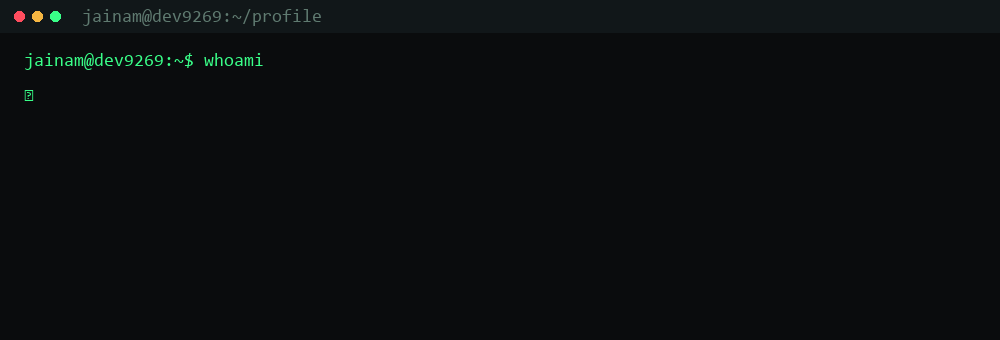
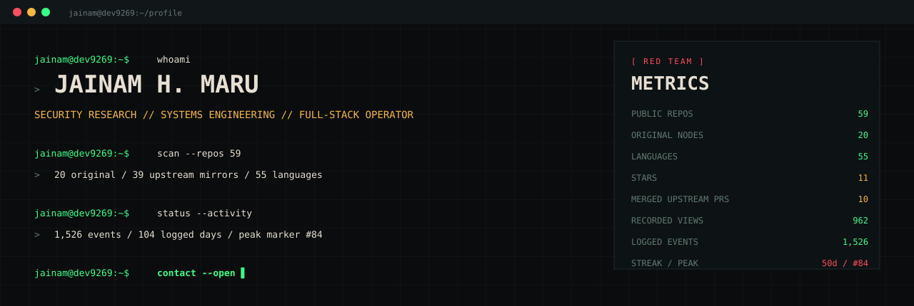
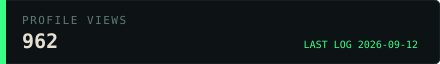
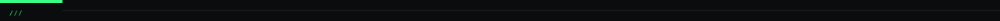
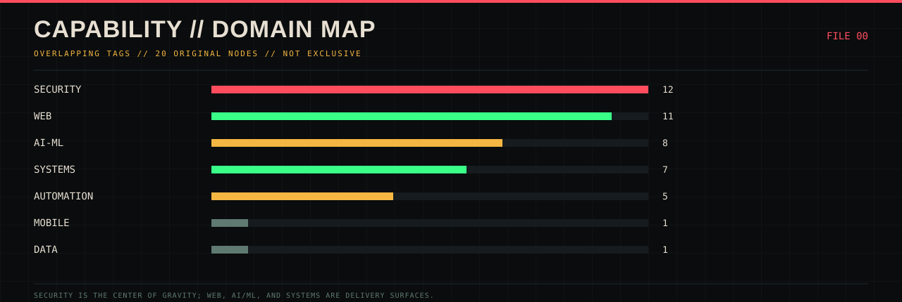
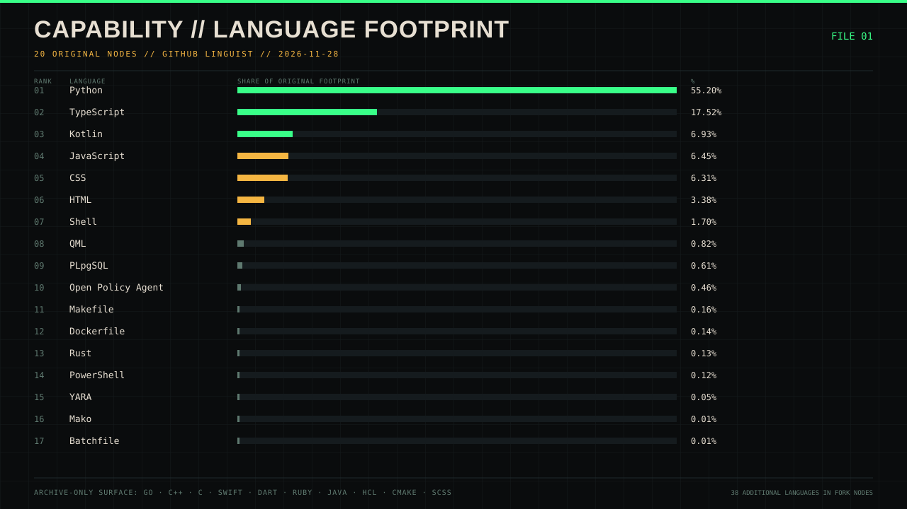

## 00 // SUBJECT

I build defensive security tooling, systems, and full-stack products. My work sits between threat intelligence and engineering: collecting attacker behavior, mapping it to MITRE ATT&CK, and shipping the result with tests, CI, and documentation.

**CURRENT OP:** [EduOS](https://github.com/Dev9269/eduos) — an open-source operating system for learning, secure examinations, cybersecurity training, and campus administration.

**FOCUS:**

- **Threat intelligence and detection engineering** — honeypots, dark-web OSINT, MITRE ATT&CK mapping.
- **Zero-trust architecture** — CISA ZTMM-aligned lab with OPA, OAuth2 Proxy, and mTLS.
- **AI for security** — LLM-assisted triage, PE malware classification, explainable ML.
- **Product engineering** — Python, TypeScript, React, Expo, FastAPI, and PostgreSQL.

> **CASE NOTE //** Every system has a story. I read the ones it tries to hide.

## 01 // SIGNALS

 

**PROFILE VIEWS:** 962 recorded as of `2026-09-12`. The badge is generated from `profile-views.json` and refreshes with the daily workflow.

**ACTIVITY LOG:** 1,526 events across 104 logged days; current consecutive run `50` days; peak marker `#84`. This is logged repository activity, not an external streak claim.

## 02 // CAPABILITY MAP

<strong>FULL LANGUAGE SURFACE // 55 LANGUAGES</strong>

Language presence is measured from GitHub Linguist bytes across all 59 public nodes. A language that appears only in fork nodes is upstream surface, not claimed as original work.

| LANGUAGE | ORIGINAL NODES | FORK NODES | ORIGINAL SHARE |
| --- | ---: | ---: | ---: |
| Python | 10 | 30 | 55.20% |
| TypeScript | 3 | 14 | 17.52% |
| Kotlin | 1 | 2 | 6.93% |
| JavaScript | 10 | 22 | 6.45% |
| CSS | 9 | 21 | 6.31% |
| HTML | 12 | 19 | 3.38% |
| Shell | 3 | 29 | 1.70% |
| QML | 1 | 1 | 0.82% |
| PLpgSQL | 1 | 2 | 0.61% |
| Open Policy Agent | 1 | 1 | 0.46% |
| Makefile | 4 | 19 | 0.16% |
| Dockerfile | 7 | 25 | 0.14% |
| Rust | 1 | 2 | 0.13% |
| PowerShell | 2 | 2 | 0.12% |
| YARA | 1 | 0 | 0.05% |
| Mako | 1 | 0 | 0.01% |
| Batchfile | 1 | 1 | 0.01% |
| Go | 0 | 12 | — |
| C++ | 0 | 3 | — |
| Swift | 0 | 2 | — |
| Dart | 0 | 2 | — |
| C | 0 | 5 | — |
| Ruby | 0 | 3 | — |
| MDX | 0 | 1 | — |
| Java | 0 | 4 | — |
| CMake | 0 | 1 | — |
| XSLT | 0 | 1 | — |
| HCL | 0 | 2 | — |
| Common Workflow Language | 0 | 1 | — |
| SCSS | 0 | 3 | — |
| Objective-C++ | 0 | 1 | — |
| Assembly | 0 | 2 | — |
| Jinja | 0 | 3 | — |
| Astro | 0 | 1 | — |
| Objective-C | 0 | 2 | — |
| ActionScript | 0 | 1 | — |
| templ | 0 | 1 | — |
| Go Template | 0 | 4 | — |
| R | 0 | 1 | — |
| ANTLR | 0 | 1 | — |
| Perl | 0 | 3 | — |
| C# | 0 | 2 | — |
| Linker Script | 0 | 1 | — |
| Inno Setup | 0 | 1 | — |
| Nix | 0 | 1 | — |
| Nunjucks | 0 | 1 | — |
| SaltStack | 0 | 1 | — |
| PHP | 0 | 1 | — |
| Svelte | 0 | 1 | — |
| TeX | 0 | 1 | — |
| Tcl | 0 | 1 | — |
| Solidity | 0 | 1 | — |
| Pascal | 0 | 1 | — |
| Lua | 0 | 1 | — |
| Scheme | 0 | 1 | — |

### DETECTED TOOLING

| DIRECTORY | VERIFIED TOOLING |
| --- | --- |
| **SECURITY / RESEARCH** | Python · FastAPI · Flask · YARA · MITRE ATT&CK · Tor/stem · Paramiko · Cryptography · Passlib · bcrypt · Argon2 · PyJWT · GeoIP2 · Ollama · Groq |
| **WEB / PRODUCT** | TypeScript · React · Vite · Tailwind CSS · Radix UI · TanStack Query · Zustand · React Router · Recharts · Cytoscape.js · Framer Motion · Expo · React Native |
| **SYSTEMS / CLOUD** | Linux · PyQt6 · QML · Docker · Docker Compose · Nginx · OPA/Rego · OAuth2 Proxy · Authentik · PostgreSQL · SQLite · Supabase · Cloudflare R2 · Grafana · Loki · Promtail |
| **ML / DATA** | scikit-learn · XGBoost · LightGBM · SHAP · pandas · NumPy · joblib · spaCy · NetworkX · EMBER |
| **WEB3** | Rust · Soroban · Stellar SDK · Freighter · Midnight.js · Compact · Lace |
| **CI / QUALITY** | GitHub Actions · pytest · Playwright · Vitest · Jest · ESLint · Prettier · Ruff · Black · Flake8 · Mypy · Bandit · pip-audit · pre-commit |

## 03 // OPERATIONS

Eight original nodes selected from 20. Stacks are taken from manifests, build files, and CI—not guesses. The full archive is in File 05.

| CASE FILE // A | CASE FILE // B |
| --- | --- |
| **[RED] OP-01 // DARKFORCE** [`SOURCE`](https://github.com/Dev9269/darkforce) Dark-web threat intelligence with Tor/clearnet collection, actor entity resolution, and an interactive relationship graph. <code>Python · FastAPI · React · Cytoscape.js · Tor</code> | **[RED] OP-02 // SSH HONEYPOT** [`SOURCE`](https://github.com/Dev9269/ssh-honeypot) AI-powered SSH deception that captures attacker behavior, maps it to MITRE ATT&CK, and scores threat. <code>Python · Paramiko · Ollama · MITRE ATT&CK</code> |
| **[AMBER] OP-03 // ZERO TRUST LAB** [`SOURCE`](https://github.com/Dev9269/zero-trust-lab) CISA ZTMM-aligned lab implementing a self-hosted zero-trust gateway stack. <code>nginx · OPA · OAuth2 Proxy · Authentik</code> | **[RED] OP-04 // MALWARE DETECTOR** [`SOURCE`](https://github.com/Dev9269/malware-detector) PE malware classifier using YARA, Random Forest, EMBER features, and SHAP explanations. <code>Python · scikit-learn · YARA · SHAP · EMBER</code> |
| **[AMBER] OP-05 // AEGIS NEXUS AI** [`SOURCE`](https://github.com/Dev9269/aegis-nexus-ai) Security operations command center with audit trails, risk scoring, and analyst workflows. <code>FastAPI · React · TanStack Query · SQLite</code> | **[AMBER] OP-06 // EDUOS** [`SOURCE`](https://github.com/Dev9269/eduos) Open-source operating system for learning, secure examinations, cybersecurity training, and campus administration. <code>Python · PyQt6 · FastAPI · QML</code> |
| **[RED] OP-07 // VAJRA OSINT** [`SOURCE`](https://github.com/Dev9269/vajra-osint) Self-updating OSINT aggregator with entity resolution and threat-intelligence workflows. <code>Python · FastAPI · HTML · OSINT</code> | **[GREEN] OP-08 // DUSKWAVE** [`SOURCE`](https://github.com/Dev9269/duskwave) Dark editorial music streaming app with catalog search, playback, and cloud media storage. <code>Expo · TypeScript · Supabase · Cloudflare R2</code> |

## 04 // UPSTREAM

**STATUS:** 10 merged PRs across 9 upstream projects.

| TARGET | PATCH | CHANGE |
| --- | --- | --- |
| [beeware/toga](https://github.com/beeware/toga) | [#4632](https://github.com/beeware/toga/pull/4632) / [#4633](https://github.com/beeware/toga/pull/4633) | Fixed AsyncResult truthiness and SplitContainer assignment handling. |
| [jupyterhub/kubespawner](https://github.com/jupyterhub/kubespawner) | [#933](https://github.com/jupyterhub/kubespawner/pull/933) | Fixed implicit string concatenation breaking the singleuser_lifecycle_hooks deprecation. |
| [pschanely/CrossHair](https://github.com/pschanely/CrossHair) | [#501](https://github.com/pschanely/CrossHair/pull/501) | Fixed keyword-only argument crash and max_iterations=0 handling. |
| [beeware/briefcase](https://github.com/beeware/briefcase) | [#3128](https://github.com/beeware/briefcase/pull/3128) | Corrected the uninstall option error message. |
| [safedep/vet](https://github.com/safedep/vet) | [#768](https://github.com/safedep/vet/pull/768) | Emit spec-compliant PURLs for distro ecosystems. |
| [spore-host/spawn](https://github.com/spore-host/spawn) | [#554](https://github.com/spore-host/spawn/pull/554) | Skip unassociated EIPs tagged aws:* during orphan detection. |
| [Nayjest/Gito](https://github.com/Nayjest/Gito) | [#318](https://github.com/Nayjest/Gito/pull/318) | Fixed None crashes in answer and deploy paths. |
| [lissy93/web-check](https://github.com/lissy93/web-check) | [#314](https://github.com/lissy93/web-check/pull/314) | Fixed typos, grammar, and broken links in documentation. |
| [OWASP/CheatSheetSeries](https://github.com/OWASP/CheatSheetSeries) | [#1549](https://github.com/OWASP/CheatSheetSeries/pull/1549) | Grammar fixes on the SQL Injection Prevention Cheat Sheet. |

## 05 // ARCHIVE

<strong>FULL ARCHIVE // 59 PUBLIC NODES</strong> — 20 original / 39 forks

Fork nodes are upstream mirrors. They are not counted as original work or in the language matrix. Fork descriptions are upstream project summaries.

### ORIGINAL NODES // 20

| NODE | PRIMARY | STARS | DESCRIPTION |
| --- | --- | ---: | --- |
| **[aegis-nexus-ai](https://github.com/Dev9269/aegis-nexus-ai)** | TypeScript | 3 | AEGIS NEXUS AI - security operations command center (FastAPI + React) |
| **[ai-chatbot](https://github.com/Dev9269/ai-chatbot)** | JavaScript | 0 | AI Chatbot with Groq AI, image search, dark/light mode - JS frontend + Python backend |
| **[bitchat-messenger](https://github.com/Dev9269/bitchat-messenger)** | Kotlin | 0 | — |
| **[crpf-soc-dashboard](https://github.com/Dev9269/crpf-soc-dashboard)** | CSS | 0 | CRPF Centralized Security Monitoring Dashboard - SOC command centre prototype (SIH) |
| **[daily-notes](https://github.com/Dev9269/daily-notes)** | Python | 0 | Daily notes, scripts and learnings |
| **[darkforce](https://github.com/Dev9269/darkforce)** | Python | 0 | Dark web threat intelligence platform - OSINT collection, actor entity resolution and an interactive relationship graph. FastAPI + React + Cytoscape.js,… |
| **[dev-fitness](https://github.com/Dev9269/dev-fitness)** | JavaScript | 0 | — |
| **[Dev9269](https://github.com/Dev9269/Dev9269)** | — | 2 | Security research, systems engineering, and open-source projects by Jainam H. Maru. |
| **[Dev9269.github.io](https://github.com/Dev9269/Dev9269.github.io)** | HTML | 0 | — |
| **[duskwave](https://github.com/Dev9269/duskwave)** | TypeScript | 0 | Dark, editorial music streaming app built with Expo, Supabase, and Cloudflare R2 |
| **[eduos](https://github.com/Dev9269/eduos)** | Python | 0 | EduOS - unified operating system for learning, secure examinations, cybersecurity training, software development, and campus administration |
| **[greenheavens-co-site](https://github.com/Dev9269/greenheavens-co-site)** | CSS | 0 | Green Havens / Shining Star contracting website (static) |
| **[malware-detector](https://github.com/Dev9269/malware-detector)** | JavaScript | 3 | AI-powered PE malware detector - static analysis, YARA rules, Random Forest + EMBER 2381-feature ML, SHAP explainability |
| **[midnight-moonshots](https://github.com/Dev9269/midnight-moonshots)** | JavaScript | 0 | PrivatePay - privacy-first payroll &amp; splits on Midnight (Compact contract, Midnight.js SDK, Lace frontend, tests, CI). Monthly Moonshots on Midnight… |
| **[password-cracker-toolkit](https://github.com/Dev9269/password-cracker-toolkit)** | Python | 2 | Industrial-grade password cracking toolkit - mask attack, rule engine, combinator, session persistence, multiprocessing |
| **[paylink](https://github.com/Dev9269/paylink)** | JavaScript | 0 | PayLink - shareable XLM payment links backed by a Soroban escrow contract (Rust). Levels 1-3: Freighter dApp, contract integration + multisig, merchant… |
| **[portfolio](https://github.com/Dev9269/portfolio)** | JavaScript | 1 | Personal portfolio - React + Vite. Projects, skills, and journey in cybersecurity &amp; full-stack engineering. |
| **[ssh-honeypot](https://github.com/Dev9269/ssh-honeypot)** | Python | 0 | AI-powered SSH honeypot - Ollama threat analysis, MITRE ATT&amp;CK mapping, real-time dashboards for threat intelligence collection |
| **[vajra-osint](https://github.com/Dev9269/vajra-osint)** | Python | 0 | VAJRA Layer 3 - Self-Updating OSINT Aggregator (SIH 2026) |
| **[zero-trust-lab](https://github.com/Dev9269/zero-trust-lab)** | Python | 0 | CISA Zero Trust Maturity Model lab - self-hosted gateway stack with nginx + oauth2-proxy + OPA + authz-bridge |

### FORK NODES // 39

| NODE | PRIMARY | DESCRIPTION |
| --- | --- | --- |
| **[axonflow](https://github.com/Dev9269/axonflow)** | Go | AxonFlow: Runtime control layer for production AI |
| **[beef](https://github.com/Dev9269/beef)** | JavaScript | The Browser Exploitation Framework Project |
| **[briefcase](https://github.com/Dev9269/briefcase)** | Python | Tools to support converting a Python project into a standalone native application. |
| **[CheatSheetSeries](https://github.com/Dev9269/CheatSheetSeries)** | Python | The OWASP Cheat Sheet Series was created to provide a concise collection of high value information on specific application security topics. |
| **[CrossHair](https://github.com/Dev9269/CrossHair)** | Python | An analysis tool for Python that blurs the line between testing and type systems. |
| **[crpf-sentinel](https://github.com/Dev9269/crpf-sentinel)** | TypeScript | — |
| **[cve-bin-tool](https://github.com/Dev9269/cve-bin-tool)** | Python | The CVE Binary Tool helps you determine if your system includes known vulnerabilities. You can scan binaries for over 350 common, vulnerable… |
| **[cwltool](https://github.com/Dev9269/cwltool)** | Python | Common Workflow Language reference implementation |
| **[dep-scan](https://github.com/Dev9269/dep-scan)** | Python | OWASP dep-scan is a next-generation security and risk audit tool based on known vulnerabilities, advisories, and license limitations for project… |
| **[docker-net-dhcp](https://github.com/Dev9269/docker-net-dhcp)** | Go | Docker network plugin: containers get real DHCP leases from your LAN's DHCP server instead of Docker IPAM. Bridge, macvlan and ipvlan modes.… |
| **[fastapi](https://github.com/Dev9269/fastapi)** | Python | FastAPI framework, high performance, easy to learn, fast to code, ready for production |
| **[Gito](https://github.com/Dev9269/Gito)** | Python | An AI-powered GitHub code review tool that uses LLMs to detect high-confidence, high-impact issues—such as security vulnerabilities, bugs, and… |
| **[hugo](https://github.com/Dev9269/hugo)** | Go | The world’s fastest framework for building websites. |
| **[kana-dojo](https://github.com/Dev9269/kana-dojo)** | TypeScript | Aesthetic, minimalist platform for learning Japanese inspired by Duolingo and Monkeytype, built with Next.js and sponsored by Vercel.… |
| **[kubespawner](https://github.com/Dev9269/kubespawner)** | Python | Kubernetes spawner for JupyterHub |
| **[mu](https://github.com/Dev9269/mu)** | Go | Work with Agents |
| **[Nest](https://github.com/Dev9269/Nest)** | Python | Your gateway to OWASP. Discover, engage, and help shape the future! |
| **[orkestra](https://github.com/Dev9269/orkestra)** | Go | — |
| **[pre-commit](https://github.com/Dev9269/pre-commit)** | Python | A framework for managing and maintaining multi-language pre-commit hooks. |
| **[pypsa-earth](https://github.com/Dev9269/pypsa-earth)** | Python | PyPSA-Earth: A flexible Python-based open optimisation model to study energy system futures around the world. |
| **[rea](https://github.com/Dev9269/rea)** | TypeScript | Reverse engineer anything with agents, from app behavior down to native binaries. |
| **[runanywhere-sdks](https://github.com/Dev9269/runanywhere-sdks)** | C++ | Production ready toolkit to run AI locally |
| **[scanapi](https://github.com/Dev9269/scanapi)** | Python | Automated Integration Testing and Live Documentation for your API |
| **[sherlock](https://github.com/Dev9269/sherlock)** | Python | Hunt down social media accounts by username across social networks |
| **[skateboard-](https://github.com/Dev9269/skateboard-)** | TypeScript | skateboard |
| **[slipspace-gateway](https://github.com/Dev9269/slipspace-gateway)** | Go | A modern, simple AI gateway. |
| **[social-analyzer](https://github.com/Dev9269/social-analyzer)** | JavaScript | API, CLI, and Web App for analyzing and finding a person's profile in 1000 social media \ websites |
| **[spawn](https://github.com/Dev9269/spawn)** | Go | Launch and manage EC2 instances with automatic lifecycle management |
| **[story-teller-](https://github.com/Dev9269/story-teller-)** | TypeScript | Interactive 3D cinematic storytelling website with lofi ambient music |
| **[streamlit](https://github.com/Dev9269/streamlit)** | Python | Streamlit — A faster way to build and share data apps. |
| **[student-to-contributor](https://github.com/Dev9269/student-to-contributor)** | JavaScript | Student → Contributor: AI-Assisted Development, Git, GitHub &amp; Open Source workshop |
| **[sympy](https://github.com/Dev9269/sympy)** | Python | A computer algebra system written in pure Python |
| **[system-design-primer](https://github.com/Dev9269/system-design-primer)** | Python | Learn how to design large-scale systems. Prep for the system design interview.  Includes Anki flashcards. |
| **[toga](https://github.com/Dev9269/toga)** | Python | A Python native, OS native GUI toolkit. |
| **[trivy-checks](https://github.com/Dev9269/trivy-checks)** | Open Policy Agent | — |
| **[vet](https://github.com/Dev9269/vet)** | Go | Protect against malicious open source packages 🤖 |
| **[web-check](https://github.com/Dev9269/web-check)** | TypeScript | 🕵️‍♂️ All-in-one OSINT tool for analysing any website |
| **[wttr.in](https://github.com/Dev9269/wttr.in)** | Go | :partly_sunny: The right way to check the weather |
| **[xyne](https://github.com/Dev9269/xyne)** | TypeScript | AI-first Search &amp; Answer Engine for work. Open-source alternative to Glean. |

## 06 // CONTACT

| CHANNEL | ENDPOINT |
| --- | --- |
| **EMAIL** | [Jainammaru567000@gmail.com](mailto:Jainammaru567000@gmail.com) |
| **PORTFOLIO** | [dev9269.github.io/portfolio](https://dev9269.github.io/portfolio/) |
| **LINKEDIN** | [jainam-h-maru](https://www.linkedin.com/in/jainam-h-maru) |
| **X** | [@Dev9269Git](https://x.com/Dev9269Git) |
| **BLUESKY** | [@dev9269.bsky.social](https://bsky.app/profile/dev9269.bsky.social) |
| **DEV.TO** | [dev9269](https://dev.to/dev9269) |

PUBLIC RELEASE // TERMINAL DOSSIER 2.0 // 2026

